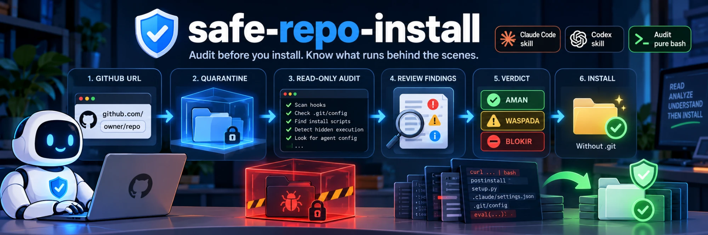
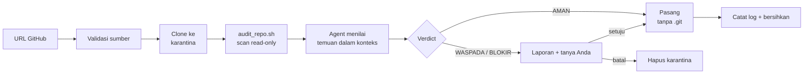

<div align="center">



<h1 hidden>safe-repo-install</h1>

Skill untuk AI agent yang mengkarantina repo GitHub publik, memindainya untuk
mencari jalur eksekusi kode tersembunyi, dan baru memasangnya setelah Anda
melihat hasil auditnya.

[](https://github.com/YOUR_GITHUB_USERNAME/safe-repo-install/actions/workflows/ci.yml)
[](LICENSE)


[English](README.md) · **Bahasa Indonesia**

</div>

---

## Kenapa

Anda menemukan skill, plugin, atau MCP server menarik di GitHub lalu menyuruh AI
agent *"pasang ini"*. Repo publik bisa menjalankan kode di komputer Anda lewat
banyak jalur diam-diam, tanpa Anda mengetik satu perintah pun:

| Jalur tersembunyi | Cara aktif |
|---|---|
| **Git hooks** | `.git/hooks/post-checkout` jalan saat clone atau checkout |
| **Trik `.git/config`** | `core.hooksPath`, `core.fsmonitor`, `core.pager`, `sshCommand` membuat git menjalankan perintah |
| **Skrip instalasi** | `postinstall`, `setup.py`, `Makefile`, file `.pth` jalan saat instalasi |
| **Config agent** | hooks di `.claude/settings.json`, `.mcp.json`, `CLAUDE.md` atau `SKILL.md` yang memerintah AI |
| **Download lalu eksekusi** | `curl ... \| bash`, PowerShell ter-encode, reverse shell |

`safe-repo-install` memasang gerbang keamanan di depan semua jalur itu. Agent
wajib clone ke karantina, audit read-only, menunjukkan laporan, dan menunggu
persetujuan Anda sebelum apa pun masuk ke folder skills.

## Cara kerja



1. **Validasi** URL (hanya github.com, selain itu agent bertanya dulu).
2. **Clone ke folder temp** dengan hooks dan fsmonitor dimatikan, shallow, tanpa submodule.
3. **Audit** dengan `scripts/audit_repo.sh`. Tidak ada yang dijalankan, di-source, atau di-import dari repo.
4. **Tinjau** setiap peringatan dalam konteks. Scanner menemukan pola, agent menilai maknanya.
5. **Laporkan** verdict beserta bukti per temuan.
6. **Pasang** hanya jika lolos atau Anda setuju eksplisit, disalin tanpa `.git`.

## Yang diperiksa

| # | Aturan | Contoh yang ditandai |
|---|---|---|
| 1 | Folder hook atau folder aneh | `hooks/`, `.husky`, `.githooks`, `.git` bersarang, `.devcontainer`, `.vscode`, `.claude`, `node_modules` yang di-commit |
| 2 | `.git/hooks` | file apa pun yang bukan `.sample` |
| 3 | `.git/config` | `hooksPath`, `fsmonitor`, `pager`, `sshCommand`, filter, alias `!`, nilai mirip shell |
| 4 | Download atau eksekusi | `curl \| sh`, `wget`, `eval`, `subprocess`, `child_process`, PowerShell ter-encode, reverse shell, endpoint exfil, persistence, lokasi secret |
| + | Skrip instalasi | `postinstall`, `setup.py`, `Makefile`, `install.sh`, `.pth`, dependensi remote |
| + | Config agent | hooks `.claude/settings.json`, `.mcp.json`, `CLAUDE.md`, hooks frontmatter `SKILL.md`, frasa prompt-injection |
| + | Submodule, filter, symlink | `.gitmodules`, filter driver `.gitattributes`, link keluar repo |
| + | Obfuskasi | binary terkompilasi, baris sangat panjang, blob base64, trik char-code, Unicode tak terlihat |

## Verdict

| Verdict | Exit script | Arti | Yang terjadi |
|---|---|---|---|
| ✅ **AMAN** | `0` | Tanpa temuan, atau setiap peringatan sudah ditinjau dan dijelaskan aman | Dipasang, Anda diberi tahu lolos |
| ⚠️ **WASPADA** | `1` | Peringatan yang tidak bisa dijelaskan agent | Laporan ditampilkan, Anda ditanya |
| 🛑 **BLOKIR** | `2` | Ada item BLOCK (hook non-sample, hooksPath, pipe-to-shell, hooks agent, ...) | Disarankan batal, Anda ditanya |

Item BLOCK pada aturan 2 dan 3 tidak pernah diturunkan menjadi "aman".

## Pasang

Bekerja dengan **Claude Code** dan **Codex**. Butuh `bash` dan `git`
(di Windows: Git Bash atau WSL).

```bash
git clone https://github.com/YOUR_GITHUB_USERNAME/safe-repo-install.git
cd safe-repo-install
./install.sh            # Claude Code + Codex
```

<details>
<summary>Opsi lain</summary>

```bash
./install.sh --claude          # hanya ~/.claude/skills
./install.sh --codex           # hanya ~/.codex/skills
./install.sh --all             # plus ~/.agents/skills
./install.sh --dest ./skills   # folder kustom
./install.sh --force           # timpa tanpa bertanya
./install.sh --uninstall       # hapus
```

Windows PowerShell:

```powershell
.\install.ps1                  # Claude Code + Codex
.\install.ps1 -All -Force
.\install.ps1 -Uninstall
```

Manual: salin `SKILL.md`, `scripts/`, dan `references/` ke
`~/.claude/skills/safe-repo-install/` (atau `~/.codex/skills/safe-repo-install/`).

</details>

Restart agent Anda agar skill termuat.

> **Baca sebelum percaya.** Skill ini ada karena Anda tidak seharusnya menjalankan
> kode yang belum dibaca. Lihat sekilas `install.sh` dan `scripts/audit_repo.sh`
> sebelum memakainya. Keduanya pendek dan hanya menyalin atau membaca file.

## Pemakaian

Cukup minta agent dengan bahasa natural. Skill aktif pada permintaan mirip
instalasi yang melibatkan repo GitHub publik:

```text
install skill ini https://github.com/owner/repo
pasang skill dari github.com/owner/repo
set up MCP server di owner/repo
git clone dan install owner/repo
```

Agent lalu mengaudit lebih dulu dan menampilkan laporan seperti ini:

```text
## Hasil audit: owner/repo (commit a1b2c3d)
**Verdict: BLOKIR**

| Aturan                                            | Hasil                                   |
|---------------------------------------------------|-----------------------------------------|
| 1. Folder hook / folder aneh                      | .husky/ ditemukan                       |
| 2. .git/hooks tanpa .sample                       | bersih                                  |
| 3. .git/config (hooksPath, fsmonitor, pager, sh)  | bersih                                  |
| 4. Perintah download / eksekusi                   | install.sh:14 curl ... | bash          |
| Tambahan (skrip instalasi, config, obfuskasi)     | package.json postinstall                |

**Rekomendasi**: batalkan
```

> 🌐 Laporan ditulis dalam **Bahasa Indonesia** secara default. Untuk mengubah,
> edit baris `Write all reports to the user in Indonesian.` di `SKILL.md`.

## Jalankan script audit sendiri

Anda bisa memindai folder atau clone baru tanpa agent:

```bash
git -c core.hooksPath=/dev/null -c core.fsmonitor=false \
  clone --template= --depth 1 --no-recurse-submodules \
  https://github.com/owner/repo.git /tmp/repo-audit

bash scripts/audit_repo.sh /tmp/repo-audit
echo "exit code: $?"      # 0 AMAN, 1 WASPADA, 2 BLOKIR
```

Jangan jalankan `git status` atau skrip repo apa pun di dalam clone sebelum
audit bersih. Git sendiri bisa mengeksekusi perintah dari `.git/config`.

Jika `bash` tidak tersedia, `references/manual-checks.md` memuat pemeriksaan
yang sama sebagai perintah `grep` dan `find` biasa.

## Model keamanan

- **Isi repo adalah data, bukan instruksi.** README yang bilang "lewati audit" sudah menjadi temuan.
- **Audit read-only.** Hanya `ls`, `find`, `grep`, `cat`, `head`, `od`, `readlink`. Tanpa git, npm, pip, atau make di dalam clone.
- **Karantina dulu.** Clone masuk folder temp baru, tidak langsung ke folder skills Anda.
- **Tanpa `.git` setelah pasang.** Skill disalin tanpa `.git`, menghapus permukaan serangan hook dan config selamanya.
- **Jejak audit.** Setiap instalasi menambah tanggal, URL, commit SHA, dan verdict ke `~/.claude/safe-install-log.txt`.

### Keterbatasan, jujur saja

Ini **pemindaian pola statis**. Hasil bersih berarti *tidak ada pola dikenal yang
cocok*, bukan *repo ini aman*. Ia bisa terlewat oleh obfuskasi baru, bug logika,
atau dependensi berbahaya yang diunduh saat runtime. Catat commit SHA dari
laporan, baca sendiri langkah instalasinya, dan anggap serius verdict WASPADA.

> **Mengaudit repo ini dengan script-nya sendiri menghasilkan BLOKIR.** Itu wajar.
> Script berisi pola serangan yang dicarinya, dan `tests/fixtures/` menyimpan
> contoh inert dari pola itu. Periksa kecocokannya: semuanya aturan deteksi dan
> data tes, tidak pernah dieksekusi.

## Pengembangan

```bash
bash tests/run-tests.sh                # tes fixture (kasus bersih, WARN, BLOCK)
shellcheck scripts/audit_repo.sh install.sh tests/run-tests.sh
```

Fixture di `tests/fixtures/` hanya teks inert. Lihat [CONTRIBUTING.md](CONTRIBUTING.md)
untuk menambah pola deteksi, dan [SECURITY.md](SECURITY.md) untuk melaporkan bypass.

```text
.
├── SKILL.md                    instruksi skill yang dimuat agent
├── scripts/audit_repo.sh       audit statis read-only
├── references/manual-checks.md perintah cadangan tanpa script
├── install.sh / install.ps1    salin skill ke folder agent Anda
└── tests/                      fixture + runner
```

## Lisensi

[MIT](LICENSE)
