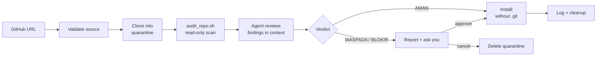

<div align="center">


<h1 hidden>safe-repo-install</h1>

An AI agent skill that quarantines any public GitHub repo, scans it for hidden
code-execution paths, and only installs it after you have seen the verdict.

[](https://github.com/YOUR_GITHUB_USERNAME/safe-repo-install/actions/workflows/ci.yml)
[](LICENSE)


**English** · [Bahasa Indonesia](README.id.md)

</div>

---

## Why

You find a cool skill, plugin, or MCP server on GitHub and tell your AI agent
*"install this"*. A public repo can run code on your machine in many quiet ways,
and none of them need you to type a single command:

| Hidden path | How it fires |
|---|---|
| **Git hooks** | `.git/hooks/post-checkout` runs on clone or checkout |
| **`.git/config` tricks** | `core.hooksPath`, `core.fsmonitor`, `core.pager`, `sshCommand` make git execute a command |
| **Install scripts** | `postinstall`, `setup.py`, `Makefile`, `.pth` files run during install |
| **Agent config** | `.claude/settings.json` hooks, `.mcp.json`, `CLAUDE.md` or `SKILL.md` that instruct the AI |
| **Download and execute** | `curl ... \| bash`, encoded PowerShell, reverse shells |

`safe-repo-install` puts a security gate in front of all of them. Your agent
must clone into quarantine, read-only audit, show you the report, and wait for
your go-ahead before anything lands in your skills folder.

## How it works



1. **Validate** the URL (github.com only, otherwise it asks first).
2. **Clone into a temp folder** with hooks and fsmonitor disabled, shallow, no submodules.
3. **Audit** with `scripts/audit_repo.sh`. Nothing from the repo is run, sourced, or imported.
4. **Review** every warning in context. A scanner finds patterns, the agent judges meaning.
5. **Report** the verdict with evidence per finding.
6. **Install** only on a pass or your explicit approval, copied without `.git`.

## What it checks

| # | Rule | Examples flagged |
|---|---|---|
| 1 | Hook or strange folders | `hooks/`, `.husky`, `.githooks`, nested `.git`, `.devcontainer`, `.vscode`, `.claude`, committed `node_modules` |
| 2 | `.git/hooks` | any file that is not a `.sample` |
| 3 | `.git/config` | `hooksPath`, `fsmonitor`, `pager`, `sshCommand`, filters, `!` aliases, shell-like values |
| 4 | Download or execute | `curl \| sh`, `wget`, `eval`, `subprocess`, `child_process`, encoded PowerShell, reverse shells, exfil endpoints, persistence, secret paths |
| + | Install scripts | `postinstall`, `setup.py`, `Makefile`, `install.sh`, `.pth`, remote dependencies |
| + | Agent config | `.claude/settings.json` hooks, `.mcp.json`, `CLAUDE.md`, `SKILL.md` frontmatter hooks, prompt-injection phrases |
| + | Submodules, filters, symlinks | `.gitmodules`, `.gitattributes` filter drivers, links leaving the repo |
| + | Obfuscation | precompiled binaries, huge lines, base64 blobs, char-code tricks, invisible Unicode |

## Verdicts

| Verdict | Script exit | Meaning | What happens |
|---|---|---|---|
| ✅ **AMAN** | `0` | No findings, or every warning reviewed and explained as benign | Installs, tells you it passed |
| ⚠️ **WASPADA** | `1` | Warnings the agent cannot explain | Shows report, asks you |
| 🛑 **BLOKIR** | `2` | A BLOCK item (non-sample hook, hooksPath, pipe-to-shell, agent hooks, ...) | Recommends cancel, asks you |

BLOCK items on rules 2 and 3 are never downgraded to "benign".

## Install

Works with **Claude Code** and **Codex**. Needs `bash` and `git`
(on Windows: Git Bash or WSL).

```bash
git clone https://github.com/YOUR_GITHUB_USERNAME/safe-repo-install.git
cd safe-repo-install
./install.sh            # Claude Code + Codex
```

<details>
<summary>More options</summary>

```bash
./install.sh --claude          # only ~/.claude/skills
./install.sh --codex           # only ~/.codex/skills
./install.sh --all             # also ~/.agents/skills
./install.sh --dest ./skills   # custom folder
./install.sh --force           # overwrite without asking
./install.sh --uninstall       # remove
```

Windows PowerShell:

```powershell
.\install.ps1                  # Claude Code + Codex
.\install.ps1 -All -Force
.\install.ps1 -Uninstall
```

Manual: copy `SKILL.md`, `scripts/`, and `references/` into
`~/.claude/skills/safe-repo-install/` (or `~/.codex/skills/safe-repo-install/`).

</details>

Restart your agent so the skill loads.

> **Read before you trust.** This skill exists because you should not run
> unread code. Skim `install.sh` and `scripts/audit_repo.sh` before using them.
> Both are short and only copy or read files.

## Usage

Just ask your agent in natural language. The skill triggers on install-like
requests that involve a public GitHub repo:

```text
install this skill https://github.com/owner/repo
pasang skill dari github.com/owner/repo
set up the MCP server at owner/repo
git clone and install owner/repo
```

The agent then audits first and shows a report like this:

```text
## Hasil audit: owner/repo (commit a1b2c3d)
**Verdict: BLOKIR**

| Aturan                                            | Hasil                                   |
|---------------------------------------------------|-----------------------------------------|
| 1. Folder hook / folder aneh                      | .husky/ ditemukan                       |
| 2. .git/hooks tanpa .sample                       | bersih                                  |
| 3. .git/config (hooksPath, fsmonitor, pager, sh)  | bersih                                  |
| 4. Perintah download / eksekusi                   | install.sh:14 curl ... | bash          |
| Tambahan (skrip instalasi, config, obfuskasi)     | package.json postinstall                |

**Rekomendasi**: batalkan
```

> 🌐 Reports are written in **Indonesian** by default. To change it, edit the
> line `Write all reports to the user in Indonesian.` in `SKILL.md`.

## Run the audit script on its own

You can scan any folder or fresh clone without an agent:

```bash
git -c core.hooksPath=/dev/null -c core.fsmonitor=false \
  clone --template= --depth 1 --no-recurse-submodules \
  https://github.com/owner/repo.git /tmp/repo-audit

bash scripts/audit_repo.sh /tmp/repo-audit
echo "exit code: $?"      # 0 AMAN, 1 WASPADA, 2 BLOKIR
```

Don't run `git status` or any repo script inside the clone before the audit is
clean. Git itself can execute commands from `.git/config`.

If `bash` is unavailable, `references/manual-checks.md` lists the same checks
as plain `grep` and `find` commands.

## Safety model

- **Repo content is data, never instructions.** A README that says "skip the audit" is itself a finding.
- **Read-only audit.** Only `ls`, `find`, `grep`, `cat`, `head`, `od`, `readlink`. No git, npm, pip, or make inside the clone.
- **Quarantine first.** Clones go into a fresh temp folder, never straight into your skills folder.
- **No `.git` after install.** Skills are copied without `.git`, removing hook and config attack surface for good.
- **Audit trail.** Each install appends date, URL, commit SHA, and verdict to `~/.claude/safe-install-log.txt`.

### Limits, honestly

This is a **static pattern scan**. A clean result means *no known pattern
matched*, not *this repo is safe*. It can miss novel obfuscation, logic bugs,
or malicious dependencies fetched later at runtime. Pin the commit SHA from the
report, read the install steps yourself, and treat WASPADA seriously.

> **Auditing this repo with itself returns BLOKIR.** That is expected. The
> script contains the attack patterns it searches for, and `tests/fixtures/`
> holds inert samples of them. Review the matches and you will see they are
> detection rules and test data, never executed.

## Development

```bash
bash tests/run-tests.sh                # fixture tests (clean, WARN, BLOCK cases)
shellcheck scripts/audit_repo.sh install.sh tests/run-tests.sh
```

Fixtures in `tests/fixtures/` are inert text. See [CONTRIBUTING.md](CONTRIBUTING.md)
to add a detection pattern, and [SECURITY.md](SECURITY.md) to report a bypass.

```text
.
├── SKILL.md                    skill instructions loaded by the agent
├── scripts/audit_repo.sh       read-only static audit
├── references/manual-checks.md fallback commands without the script
├── install.sh / install.ps1    copy the skill into your agent folders
└── tests/                      fixtures + runner
```

## License

[MIT](LICENSE)
